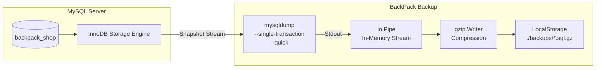

# BackPack: MySQL Crash, Disaster & Recovery Testing Guide

A comprehensive, hands-on testing guide for **BackPack** against **MySQL 8.0+**. This document outlines all real-world database disaster scenarios—human error, data corruption, process crashes, broken foreign keys, and concurrency—and provides exact instructions to simulate and recover from them.

---

## Table of Contents
1. [Architecture & How BackPack Protects MySQL](#1-architecture--how-backpack-protects-mysql)
2. [Prerequisites & Baseline Setup](#2-prerequisites--baseline-setup)
3. [Disaster Scenario 1: Accidental Table Drop (DROP TABLE)](#scenario-1-accidental-table-drop-drop-table)
4. [Disaster Scenario 2: Catastrophic Database Drop (DROP DATABASE)](#scenario-2-catastrophic-database-drop-drop-database)
5. [Disaster Scenario 3: Accidental Data Wipe (DELETE Without WHERE / TRUNCATE)](#scenario-3-accidental-data-wipe-delete-without-where)
6. [Disaster Scenario 4: Silent Data Corruption (Rogue / Malicious UPDATE)](#scenario-4-silent-data-corruption-rogue-update)
7. [Disaster Scenario 5: Foreign Key Dependency & Constraint Deadlocks](#scenario-5-foreign-key-dependency--constraint-deadlocks)
8. [Disaster Scenario 6: Process Crash & Partial Backup Prevention](#scenario-6-process-crash--partial-backup-prevention)
9. [Disaster Scenario 7: Corrupted / Tampered Backup Archive Detection](#scenario-7-corrupted--tampered-backup-archive-detection)
10. [Disaster Scenario 8: Live Concurrency (Backing Up During Active Writes)](#scenario-8-live-concurrency-backing-up-during-active-writes)
11. [Disaster Scenario 9: Selective Table Backup & Isolation](#scenario-9-selective-table-backup--isolation)
12. [Testing Checklist & Scorecard](#12-testing-checklist--scorecard)
13. [Common Windows & PowerShell Gotchas](#13-common-windows--powershell-gotchas)

---

## 1. Architecture & How BackPack Protects MySQL



BackPack's MySQL adapter provides enterprise-grade safety:
* **Zero Locking (`--single-transaction`):** Leverages InnoDB Multi-Version Concurrency Control (MVCC) to obtain a consistent point-in-time snapshot without locking tables or interrupting active application reads/writes.
* **Low Memory Footprint (`--quick` + `io.Pipe`):** Rows stream directly from MySQL into an in-memory compression pipe. No intermediate multi-gigabyte temporary files are written to disk.
* **Corrupt File Cleanup:** If a dump is interrupted or fails midway, BackPack automatically purges any partial or incomplete `.sql.gz` files from storage.
* **Credential Safety:** Credentials are never exposed on the CLI argument list; `MYSQL_PWD` is passed exclusively through internal subprocess environment variables.
* **Foreign Key Immunity:** Dumps disable foreign key checks (`SET FOREIGN_KEY_CHECKS=0;`) during restore, preventing dependency order failures.

---

## 2. Prerequisites & Baseline Setup

### 2.1 Verify MySQL Service & PATH
Make sure MySQL is running and accessible:
```powershell
Get-Service -Name "*mysql*"
```

### 2.2 Rebuild / Initialize the Test Database
Load the sample database schema and seed data using [setup_test_db.sql](file:///f:/open%20source%20projects/backpack/BackPack/setup_test_db.sql):

In **MySQL 8.0 Command Line Client**:
```sql
source f:/open source projects/backpack/BackPack/setup_test_db.sql;
```

Verify tables and row counts:
```sql
USE backpack_shop;
SHOW TABLES;
SELECT 'customers' AS tbl, COUNT(*) FROM customers
UNION ALL SELECT 'products', COUNT(*) FROM products
UNION ALL SELECT 'orders', COUNT(*) FROM orders
UNION ALL SELECT 'order_items', COUNT(*) FROM order_items;
```
*Expected: 4 customers, 4 products, 3 orders, 5 order items.*

### 2.3 Create Your Clean Baseline Backup
Before introducing crashes, take a pristine baseline backup:
```powershell
& "C:\Program Files\Go\bin\go.exe" run ./cmd/backpack backup --db mysql --host 127.0.0.1 --port 3306 --user root --password root --database backpack_shop --name baseline.sql.gz
```

Verify the backup exists:
```powershell
& "C:\Program Files\Go\bin\go.exe" run ./cmd/backpack list
```
*(You should see `baseline.sql.gz` listed in `./backups`)*

---

## Scenario 1: Accidental Table Drop (DROP TABLE)

**The Real-World Crisis:** A developer accidentally executes `DROP TABLE` or an erroneous migration script wipes out tables.

### 1. Simulate the Disaster
In MySQL Command Line Client:
```sql
USE backpack_shop;
DROP TABLE order_items;
DROP TABLE orders;
DROP TABLE customers;

SHOW TABLES;
```
> **Status:** Only `products` remains. Critical customer and order data is gone!

### 2. Execute Recovery
Run BackPack restore:
```powershell
& "C:\Program Files\Go\bin\go.exe" run ./cmd/backpack restore --db mysql --host 127.0.0.1 --port 3306 --user root --password root --database backpack_shop --file baseline.sql.gz
```

### 3. Verify Integrity
In MySQL Command Line Client:
```sql
SHOW TABLES;
SELECT * FROM customers;
```
✅ **Result:** All 4 tables are restored with schema, primary keys, and data intact.

---

## Scenario 2: Catastrophic Database Drop (DROP DATABASE)

**The Real-World Crisis:** A junior engineer drops the entire database schema (`DROP DATABASE backpack_shop;`). The database catalog entry is completely gone.

### 1. Simulate the Disaster
In MySQL Command Line Client:
```sql
DROP DATABASE backpack_shop;
SHOW DATABASES LIKE 'backpack_shop';
```
> **Status:** Empty set. The database no longer exists on the server!

### 2. Execute Recovery
Run BackPack restore:
```powershell
& "C:\Program Files\Go\bin\go.exe" run ./cmd/backpack restore --db mysql --host 127.0.0.1 --port 3306 --user root --password root --database backpack_shop --file baseline.sql.gz
```
*(BackPack automatically executes `CREATE DATABASE IF NOT EXISTS backpack_shop;` prior to streaming SQL)*

### 3. Verify Integrity
In MySQL Command Line Client:
```sql
USE backpack_shop;
SHOW TABLES;
SELECT COUNT(*) FROM customers;
```
✅ **Result:** The database schema is recreated from scratch and all tables/records are recovered!

---

## Scenario 3: Accidental Data Wipe (DELETE Without WHERE)

**The Real-World Crisis:** An engineer forgets the `WHERE` clause in `DELETE FROM customers;`. The table schema remains, but every record is wiped out.

### 1. Simulate the Disaster
In MySQL Command Line Client:
```sql
USE backpack_shop;
-- Disable foreign keys temporarily to wipe parent records
SET FOREIGN_KEY_CHECKS = 0;
DELETE FROM customers;
DELETE FROM orders;
DELETE FROM order_items;
SET FOREIGN_KEY_CHECKS = 1;

SELECT COUNT(*) FROM customers;
SELECT COUNT(*) FROM orders;
```
> **Status:** Tables exist, but count is 0 rows!

### 2. Execute Recovery
Run BackPack restore:
```powershell
& "C:\Program Files\Go\bin\go.exe" run ./cmd/backpack restore --db mysql --host 127.0.0.1 --port 3306 --user root --password root --database backpack_shop --file baseline.sql.gz
```

### 3. Verify Integrity
In MySQL Command Line Client:
```sql
SELECT COUNT(*) FROM customers;
SELECT * FROM customers;
```
✅ **Result:** All rows and original auto-increment IDs are completely restored.

---

## Scenario 4: Silent Data Corruption (Rogue UPDATE)

**The Real-World Crisis:** A faulty script or attacker modifies all emails and customer names with corrupt or scrambled values.

### 1. Simulate the Disaster
In MySQL Command Line Client:
```sql
USE backpack_shop;
UPDATE customers SET name = 'PWNED / CORRUPT', email = 'hacked@blackhat.org';
SELECT * FROM customers;
```
> **Status:** All customer records now have damaged names and emails!

### 2. Execute Recovery
Run BackPack restore:
```powershell
& "C:\Program Files\Go\bin\go.exe" run ./cmd/backpack restore --db mysql --host 127.0.0.1 --port 3306 --user root --password root --database backpack_shop --file baseline.sql.gz
```

### 3. Verify Integrity
In MySQL Command Line Client:
```sql
SELECT name, email, city FROM customers;
```
✅ **Result:** `Rajat Bansal`, `Anjani Kumar`, `John Doe`, and `Sarah Connor` have their original email addresses and names restored.

---

## Scenario 5: Foreign Key Dependency & Constraint Deadlocks

**The Real-World Crisis:** `order_items` references `orders`, which references `customers`. In standard manual SQL dumps, restoring tables out of sequence causes `Error 1452: Cannot add or update a child row: a foreign key constraint fails`.

### Why BackPack is Immune
BackPack's `mysqldump` pipeline automatically inserts:
```sql
/*!40014 SET @OLD_FOREIGN_KEY_CHECKS=@@FOREIGN_KEY_CHECKS, FOREIGN_KEY_CHECKS=0 */;
```
This temporarily suspends constraint checks during batch streaming, then re-enables them once the entire relational graph is reconstructed.

### Verification Test
1. Intentionally scramble order of rows or table creation.
2. Run BackPack restore against `baseline.sql.gz`.
3. Check foreign key enforcement:
   ```sql
   USE backpack_shop;
   -- Attempt an invalid foreign key insert
   INSERT INTO orders (customer_id, total_amount, status) VALUES (9999, 50.00, 'pending');
   ```
✅ **Result:** MySQL correctly rejects invalid foreign keys (`Error 1452`), proving that foreign key constraints were re-enabled upon completion.

---

## Scenario 6: Process Crash & Partial Backup Prevention

**The Real-World Crisis:** During a backup, the server loses network connectivity or the database credentials are wrong. Cheap backup scripts leave behind a corrupt, empty, or half-written `backup.sql.gz` file that fails during an actual restore.

### 1. Simulate the Disaster: Wrong Credentials
Run backup with an invalid password:
```powershell
& "C:\Program Files\Go\bin\go.exe" run ./cmd/backpack backup --db mysql --host 127.0.0.1 --port 3306 --user root --password WRONG_PASS --database backpack_shop --name should_not_exist.sql.gz
```

### 2. Observe BackPack's Behavior
Look at the output:
```text
level=INFO msg="Backup started" ...
level=ERROR msg="Backup failed" error="streaming compression failed: process failed (exit status 2): mysqldump: Got error: 1045: Access denied for user 'root'@'localhost' (using password: YES) when trying to connect"
```

### 3. Verify Partial File Cleanup
Check if the corrupt/partial file was left in `./backups`:
```powershell
& "C:\Program Files\Go\bin\go.exe" run ./cmd/backpack list
```
✅ **Result:** `should_not_exist.sql.gz` is **not present**! BackPack's pipeline orchestrator caught the dump failure and immediately deleted the incomplete file.

---

## Scenario 7: Corrupted / Tampered Backup Archive Detection

**The Real-World Crisis:** A backup file stored on disk suffers bit rot, bad sectors, or an incomplete network transfer.

### 1. Simulate the Disaster: Create a Corrupted File
Create a fake, broken `.sql.gz` file:
```powershell
"CORRUPTED BYTES THIS IS NOT A VALID GZIP FILE" | Out-File -FilePath .\backups\corrupted_backup.sql.gz -Encoding ascii
```

### 2. Attempt Recovery
Try to restore from the corrupted file:
```powershell
& "C:\Program Files\Go\bin\go.exe" run ./cmd/backpack restore --db mysql --host 127.0.0.1 --port 3306 --user root --password root --database backpack_shop --file corrupted_backup.sql.gz
```

### 3. Observe BackPack's Behavior
```text
level=ERROR msg="Restore failed" error="failed to initialize gzip decompressor: gzip: invalid header"
```
✅ **Result:** BackPack detects invalid gzip magic headers (`0x1f 0x8b`) and aborts immediately without sending corrupt bytes to MySQL.

---

## Scenario 8: Live Concurrency (Backing Up During Active Writes)

**The Real-World Crisis:** Taking backups on high-traffic production databases without locking tables or degrading web application response times.

### 1. The Technology: InnoDB Snapshot Isolation
BackPack runs `mysqldump` with `--single-transaction`:
* MySQL issues `START TRANSACTION WITH CONSISTENT SNAPSHOT;`.
* Reads all data as it existed at the exact moment the transaction began.
* Active transactions running `INSERT` or `UPDATE` concurrently continue without waiting on locks!

### 2. Verification Test
1. In one terminal, execute the BackPack backup:
   ```powershell
   & "C:\Program Files\Go\bin\go.exe" run ./cmd/backpack backup --db mysql --host 127.0.0.1 --port 3306 --user root --password root --database backpack_shop --name concurrent_test.sql.gz
   ```
2. While it runs, run queries in MySQL Command Line Client:
   ```sql
   INSERT INTO customers (name, email, city) VALUES ('Concurrent User', 'concurrent@test.com', 'London');
   ```
✅ **Result:** The `INSERT` query completes instantly without waiting for locks. The backup captures a consistent snapshot.

---

## Scenario 9: Selective Table Backup & Isolation

**The Real-World Crisis:** Backing up large analytical or audit tables consumes unnecessary storage when only core transactional tables are needed.

### 1. Back Up Specific Tables
Back up only `customers` and `orders`:
```powershell
& "C:\Program Files\Go\bin\go.exe" run ./cmd/backpack backup --db mysql --host 127.0.0.1 --port 3306 --user root --password root --database backpack_shop --tables customers,orders --name customers_orders.sql.gz
```

### 2. Verify File Creation
```powershell
& "C:\Program Files\Go\bin\go.exe" run ./cmd/backpack list
```

---

## 12. Testing Checklist & Scorecard

Mark each scenario as you execute tests on your local machine:

| # | Disaster / Test Scenario | Command Tested | Result |
|---|---|---|:---:|
| 1 | Baseline Full Backup | `backpack backup --db mysql` | [ ] Passed |
| 2 | Accidental Table Drop (`DROP TABLE`) | `DROP TABLE customers` -> `backpack restore` | [ ] Passed |
| 3 | Database Drop (`DROP DATABASE`) | `DROP DATABASE backpack_shop` -> `backpack restore` | [ ] Passed |
| 4 | Bulk Deletion (`DELETE FROM customers`) | `DELETE FROM customers` -> `backpack restore` | [ ] Passed |
| 5 | Data Corruption (`UPDATE customers`) | `UPDATE email = 'corrupt'` -> `backpack restore` | [ ] Passed |
| 6 | Foreign Key Cascade Ordering | Verified constraints re-enabled after restore | [ ] Passed |
| 7 | Process Failure & Cleanup | Bad password test -> verified partial file deleted | [ ] Passed |
| 8 | Corrupted Backup Detection | Corrupted gzip header -> verified aborted restore | [ ] Passed |
| 9 | Zero-Lock Concurrency | Simultaneous `INSERT` during backup | [ ] Passed |
| 10| Selective Table Backup | `backup --tables customers,orders` | [ ] Passed |

---

## 13. Common Windows & PowerShell Gotchas

1. **PowerShell Redirection Operator (`<`)**:
   In PowerShell, `<` is reserved and causes a syntax error. When restoring with BackPack, always pass the `--file` flag:
   ```powershell
   # CORRECT:
   & "C:\Program Files\Go\bin\go.exe" run ./cmd/backpack restore --db mysql --file backup.sql.gz

   # INCORRECT (Syntax error in PowerShell):
   mysql -u root -p < file.sql
   ```
2. **Angle Brackets (`<YOUR_BACKUP_FILE>`)**:
   Never include literal angle brackets `< >` in file arguments. Replace them with the exact file name:
   `--file baseline.sql.gz`
3. **Host Address (`127.0.0.1` vs `localhost`)**:
   On Windows, `localhost` may resolve to IPv6 `[::1]`. If your MySQL is configured for IPv4 only, always use `--host 127.0.0.1`.
4. **Permanent `go` in PATH**:
   If `go` is not recognized, restart VS Code or press `Ctrl + Shift + P` -> `Reload Window` to refresh environment variables.

