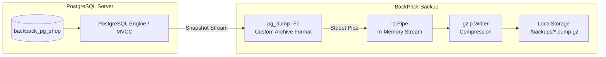

# BackPack: PostgreSQL Crash, Disaster & Recovery Testing Guide

A comprehensive, hands-on testing guide for **BackPack** against **PostgreSQL 15 / 16 / 17+**. This document details real-world database failures—human errors, drop catastrophes, silent wipes, foreign key deadlocks, process crashes, and concurrency—and provides exact instructions to simulate and recover from them.

---

## Table of Contents
1. [Architecture & How BackPack Protects PostgreSQL](#1-architecture--how-backpack-protects-postgresql)
2. [Prerequisites & Baseline Setup](#2-prerequisites--baseline-setup)
3. [Disaster Scenario 1: Accidental Table Drop (DROP TABLE)](#scenario-1-accidental-table-drop-drop-table)
4. [Disaster Scenario 2: Catastrophic Database Drop (DROP DATABASE)](#scenario-2-catastrophic-database-drop-drop-database)
5. [Disaster Scenario 3: Accidental Data Wipe (TRUNCATE / DELETE Without WHERE)](#scenario-3-accidental-data-wipe-truncate--delete-without-where)
6. [Disaster Scenario 4: Silent Data Corruption (Rogue / Malicious UPDATE)](#scenario-4-silent-data-corruption-rogue--malicious-update)
7. [Disaster Scenario 5: Foreign Key Ordering & TOC Constraint Safety](#scenario-5-foreign-key-ordering--toc-constraint-safety)
8. [Disaster Scenario 6: Process Crash & Partial Backup Prevention](#scenario-6-process-crash--partial-backup-prevention)
9. [Disaster Scenario 7: Corrupted / Tampered Backup Archive Detection](#scenario-7-corrupted--tampered-backup-archive-detection)
10. [Disaster Scenario 8: Live Concurrency (MVCC Snapshot Isolation)](#scenario-8-live-concurrency-mvcc-snapshot-isolation)
11. [Disaster Scenario 9: Selective Table Backup & Isolation](#scenario-9-selective-table-backup--isolation)
12. [Testing Checklist & Scorecard](#12-testing-checklist--scorecard)
13. [Common Windows & PostgreSQL Gotchas](#13-common-windows--postgresql-gotchas)

---

## 1. Architecture & How BackPack Protects PostgreSQL



### Why BackPack Uses Custom Archive (`-Fc`) By Default:
* **Table of Contents (TOC):** Unlike plain `.sql` scripts, `-Fc` embeds an indexed TOC separating **Pre-data** (DDL/Schemas), **Data** (table rows), and **Post-data** (indexes, foreign key constraints). This guarantees that circular dependencies restore in optimal order.
* **Selective Restoration (`-t`):** Allows restoring individual tables or schemas without parsing the entire dump.
* **Zero Locking (MVCC Snapshot Isolation):** Runs in `REPEATABLE READ` transaction mode, taking a consistent point-in-time snapshot without blocking `SELECT`, `INSERT`, or `UPDATE` queries.
* **Automatic Database Recreation:** If the entire target database is dropped, BackPack connects to the maintenance `postgres` database and creates the target database automatically.
* **Automatic Process Cleanup:** If `pg_dump` fails midway, BackPack reaps the process, captures `stderr`, and purges the incomplete `.dump.gz` file immediately.

---

## 2. Prerequisites & Baseline Setup

### 2.1 Start the PostgreSQL Windows Service
If PostgreSQL is stopped on your computer, start the service:
1. Press **`Win + R`**, type **`services.msc`**, and press **Enter**.
2. Find **`postgresql-x64-17`** (or your version).
3. Right-click and choose **Start**.

Verify it is accepting connections:
```powershell
& "C:\Program Files\PostgreSQL\17\bin\pg_isready.exe" -h 127.0.0.1 -p 5432
```
> **Output:** `127.0.0.1:5432 - accepting connections`

---

### 2.2 Rebuild / Initialize the Test Database
Load the sample relational schema and seed records using [setup_postgres_test_db.sql](file:///f:/open%20source%20projects/backpack/BackPack/setup_postgres_test_db.sql):

In PowerShell (enter your `postgres` password when prompted):
```powershell
& "C:\Program Files\PostgreSQL\17\bin\psql.exe" -h 127.0.0.1 -p 5432 -U postgres -f "f:\open source projects\backpack\BackPack\setup_postgres_test_db.sql"
```

Verify tables and row counts:
```powershell
& "C:\Program Files\PostgreSQL\17\bin\psql.exe" -h 127.0.0.1 -p 5432 -U postgres -d backpack_pg_shop -c "SELECT 'customers' AS tbl, count(*) FROM customers UNION ALL SELECT 'products', count(*) FROM products UNION ALL SELECT 'orders', count(*) FROM orders UNION ALL SELECT 'order_items', count(*) FROM order_items;"
```
*Expected: 4 customers, 4 products, 3 orders, 5 order items.*

---

### 2.3 Create Your Clean Baseline Backup
Take a baseline backup before running crash tests:
```powershell
& "C:\Program Files\Go\bin\go.exe" run ./cmd/backpack backup --db postgres --host 127.0.0.1 --port 5432 --user postgres --password YOUR_POSTGRES_PASSWORD --database backpack_pg_shop --name pg_baseline.dump.gz
```

Verify the backup exists:
```powershell
& "C:\Program Files\Go\bin\go.exe" run ./cmd/backpack list
```
*(You will see `pg_baseline.dump.gz` in `./backups`)*

---

## Scenario 1: Accidental Table Drop (DROP TABLE)

**The Real-World Crisis:** An engineer or automated script drops tables with `CASCADE`.

### 1. Simulate the Disaster
In PowerShell or `psql`:
```powershell
& "C:\Program Files\PostgreSQL\17\bin\psql.exe" -h 127.0.0.1 -p 5432 -U postgres -d backpack_pg_shop -c "DROP TABLE order_items CASCADE; DROP TABLE orders CASCADE; DROP TABLE customers CASCADE;"
```
Verify they are gone:
```powershell
& "C:\Program Files\PostgreSQL\17\bin\psql.exe" -h 127.0.0.1 -p 5432 -U postgres -d backpack_pg_shop -c "\dt"
```
> **Status:** Only `products` remains.

### 2. Execute Recovery
```powershell
& "C:\Program Files\Go\bin\go.exe" run ./cmd/backpack restore --db postgres --host 127.0.0.1 --port 5432 --user postgres --password YOUR_POSTGRES_PASSWORD --database backpack_pg_shop --file pg_baseline.dump.gz
```

### 3. Verify Integrity
```powershell
& "C:\Program Files\PostgreSQL\17\bin\psql.exe" -h 127.0.0.1 -p 5432 -U postgres -d backpack_pg_shop -c "SELECT count(*) FROM customers;"
```
✅ **Result:** All 4 tables, foreign keys, and records are restored!

---

## Scenario 2: Catastrophic Database Drop (DROP DATABASE)

**The Real-World Crisis:** Someone deletes the entire database (`DROP DATABASE backpack_pg_shop;`).

### 1. Simulate the Disaster
```powershell
& "C:\Program Files\PostgreSQL\17\bin\psql.exe" -h 127.0.0.1 -p 5432 -U postgres -d postgres -c "DROP DATABASE backpack_pg_shop;"
```
Verify:
```powershell
& "C:\Program Files\PostgreSQL\17\bin\psql.exe" -h 127.0.0.1 -p 5432 -U postgres -d postgres -c "\l backpack_pg_shop"
```
> **Status:** Database `backpack_pg_shop` does not exist on the server.

### 2. Execute Recovery
Run BackPack restore:
```powershell
& "C:\Program Files\Go\bin\go.exe" run ./cmd/backpack restore --db postgres --host 127.0.0.1 --port 5432 --user postgres --password YOUR_POSTGRES_PASSWORD --database backpack_pg_shop --file pg_baseline.dump.gz
```
*(BackPack automatically issues `CREATE DATABASE "backpack_pg_shop";` against the maintenance database before streaming into `pg_restore`)*

### 3. Verify Integrity
```powershell
& "C:\Program Files\PostgreSQL\17\bin\psql.exe" -h 127.0.0.1 -p 5432 -U postgres -d backpack_pg_shop -c "\dt"
```
✅ **Result:** The database was recreated from scratch and all tables/data recovered!

---

## Scenario 3: Accidental Data Wipe (TRUNCATE / DELETE Without WHERE)

**The Real-World Crisis:** An engineer runs `TRUNCATE TABLE customers CASCADE;`. Table schemas remain, but all rows are gone.

### 1. Simulate the Disaster
```powershell
& "C:\Program Files\PostgreSQL\17\bin\psql.exe" -h 127.0.0.1 -p 5432 -U postgres -d backpack_pg_shop -c "TRUNCATE TABLE customers CASCADE;"
```
Verify counts:
```powershell
& "C:\Program Files\PostgreSQL\17\bin\psql.exe" -h 127.0.0.1 -p 5432 -U postgres -d backpack_pg_shop -c "SELECT count(*) FROM customers; SELECT count(*) FROM orders;"
```
> **Status:** Tables exist, but count is 0!

### 2. Execute Recovery
```powershell
& "C:\Program Files\Go\bin\go.exe" run ./cmd/backpack restore --db postgres --host 127.0.0.1 --port 5432 --user postgres --password YOUR_POSTGRES_PASSWORD --database backpack_pg_shop --file pg_baseline.dump.gz
```

### 3. Verify Integrity
```powershell
& "C:\Program Files\PostgreSQL\17\bin\psql.exe" -h 127.0.0.1 -p 5432 -U postgres -d backpack_pg_shop -c "SELECT count(*) FROM customers; SELECT count(*) FROM orders;"
```
✅ **Result:** All rows and serial sequence states are repopulated.

---

## Scenario 4: Silent Data Corruption (Rogue / Malicious UPDATE)

**The Real-World Crisis:** A buggy background job or malicious update scrambles emails and names across the customer table.

### 1. Simulate the Disaster
```powershell
& "C:\Program Files\PostgreSQL\17\bin\psql.exe" -h 127.0.0.1 -p 5432 -U postgres -d backpack_pg_shop -c "UPDATE customers SET email = 'corrupted@spam.org', name = 'HACKED';"
```

### 2. Execute Recovery
```powershell
& "C:\Program Files\Go\bin\go.exe" run ./cmd/backpack restore --db postgres --host 127.0.0.1 --port 5432 --user postgres --password YOUR_POSTGRES_PASSWORD --database backpack_pg_shop --file pg_baseline.dump.gz
```

### 3. Verify Integrity
```powershell
& "C:\Program Files\PostgreSQL\17\bin\psql.exe" -h 127.0.0.1 -p 5432 -U postgres -d backpack_pg_shop -c "SELECT name, email FROM customers;"
```
✅ **Result:** Original names (`Rajat Bansal`, `Anjani Kumar`, etc.) and emails are restored!

---

## Scenario 5: Foreign Key Ordering & TOC Constraint Safety

**The Real-World Crisis:** In traditional plain SQL backups, parent and child tables must be imported in strict hierarchical sequence, otherwise foreign key violations abort the restore.

### Why BackPack is Immune
BackPack's `-Fc` dump format stores a Table of Contents (TOC). During `pg_restore`:
1. **Pre-data section:** All tables are created without foreign keys.
2. **Data section:** Data is populated into all tables.
3. **Post-data section:** Foreign keys, unique constraints, and indexes are created and validated.

### Verification Test
Attempt an invalid foreign key insert to verify constraints are actively enforced:
```powershell
& "C:\Program Files\PostgreSQL\17\bin\psql.exe" -h 127.0.0.1 -p 5432 -U postgres -d backpack_pg_shop -c "INSERT INTO orders (customer_id, total_amount, status) VALUES (9999, 100.00, 'pending');"
```
✅ **Result:** PostgreSQL rejects the insert (`insert or update on table "orders" violates foreign key constraint "orders_customer_id_fkey"`), proving relational constraints are active.

---

## Scenario 6: Process Crash & Partial Backup Prevention

**The Real-World Crisis:** A backup script with invalid credentials fails, leaving a corrupt, empty, or partial `.dump.gz` in your storage directory.

### 1. Simulate the Disaster: Bad Credentials
```powershell
& "C:\Program Files\Go\bin\go.exe" run ./cmd/backpack backup --db postgres --host 127.0.0.1 --port 5432 --user postgres --password WRONG_PASS --database backpack_pg_shop --name should_not_exist.dump.gz
```

### 2. Observe BackPack's Behavior
```text
level=INFO msg="Backup started" ...
level=ERROR msg="Backup failed" error="streaming compression failed: process failed: pg_dump: error: password authentication failed for user \"postgres\""
```

### 3. Verify Partial File Cleanup
```powershell
& "C:\Program Files\Go\bin\go.exe" run ./cmd/backpack list
```
✅ **Result:** `should_not_exist.dump.gz` was deleted from `./backups` immediately upon failure!

---

## Scenario 7: Corrupted / Tampered Backup Archive Detection

**The Real-World Crisis:** A backup archive suffers bit corruption on disk or incomplete download.

### 1. Simulate the Disaster: Create a Corrupted Archive
```powershell
"INVALID GZIP CONTENT" | Out-File -FilePath .\backups\corrupted.dump.gz -Encoding ascii
```

### 2. Attempt Recovery
```powershell
& "C:\Program Files\Go\bin\go.exe" run ./cmd/backpack restore --db postgres --host 127.0.0.1 --port 5432 --user postgres --password YOUR_POSTGRES_PASSWORD --database backpack_pg_shop --file corrupted.dump.gz
```

### 3. Observe BackPack's Behavior
```text
level=ERROR msg="Restore failed" error="failed to initialize gzip decompressor: gzip: invalid header"
```
✅ **Result:** BackPack detects invalid gzip headers and halts before touching the PostgreSQL database.

---

## Scenario 8: Live Concurrency (MVCC Snapshot Isolation)

**The Real-World Crisis:** Running backups during heavy customer transactions without locking tables or degrading read/write traffic.

### 1. The Technology: MVCC Snapshot Isolation
`pg_dump` begins a transaction in `REPEATABLE READ` mode. It acquires an `ACCESS SHARE` lock on tables (which permits concurrent `SELECT`, `INSERT`, `UPDATE`, and `DELETE` statements).

### 2. Verification Test
1. Start BackPack backup:
   ```powershell
   & "C:\Program Files\Go\bin\go.exe" run ./cmd/backpack backup --db postgres --host 127.0.0.1 --port 5432 --user postgres --password YOUR_POSTGRES_PASSWORD --database backpack_pg_shop --name concurrent_test.dump.gz
   ```
2. Concurrently insert a row in another window:
   ```powershell
   & "C:\Program Files\PostgreSQL\17\bin\psql.exe" -h 127.0.0.1 -p 5432 -U postgres -d backpack_pg_shop -c "INSERT INTO customers (name, email, city) VALUES ('Concurrent User', 'concurrent@test.io', 'Paris');"
   ```
✅ **Result:** The `INSERT` executes instantly without blocking. The backup captures a clean snapshot consistent with the exact moment the dump started.

---

## Scenario 9: Selective Table Backup & Isolation

**The Real-World Crisis:** Only a specific table or subset of tables needs to be archived.

### 1. Back Up Targeted Tables
Back up only `customers` and `orders`:
```powershell
& "C:\Program Files\Go\bin\go.exe" run ./cmd/backpack backup --db postgres --host 127.0.0.1 --port 5432 --user postgres --password YOUR_POSTGRES_PASSWORD --database backpack_pg_shop --tables customers,orders --name pg_selective.dump.gz
```

### 2. Verify File Creation
```powershell
& "C:\Program Files\Go\bin\go.exe" run ./cmd/backpack list
```

---

## 12. Testing Checklist & Scorecard

| # | Disaster / Test Scenario | Command Tested | Result |
|---|---|---|:---:|
| 1 | Baseline Full Backup | `backpack backup --db postgres` | [ ] Passed |
| 2 | Accidental Table Drop (`DROP TABLE`) | `DROP TABLE customers` -> `backpack restore` | [ ] Passed |
| 3 | Database Drop (`DROP DATABASE`) | `DROP DATABASE backpack_pg_shop` -> `backpack restore` | [ ] Passed |
| 4 | Bulk Deletion (`TRUNCATE TABLE`) | `TRUNCATE customers CASCADE` -> `backpack restore` | [ ] Passed |
| 5 | Data Corruption (`UPDATE customers`) | `UPDATE email = 'corrupt'` -> `backpack restore` | [ ] Passed |
| 6 | Foreign Key TOC Ordering | Verified constraints re-enabled after restore | [ ] Passed |
| 7 | Process Failure & Cleanup | Bad password test -> verified partial file deleted | [ ] Passed |
| 8 | Corrupted Backup Detection | Corrupted gzip header -> verified aborted restore | [ ] Passed |
| 9 | Zero-Lock Concurrency | Simultaneous `INSERT` during backup | [ ] Passed |
| 10| Selective Table Backup | `backup --tables customers,orders` | [ ] Passed |

---

## 13. Common Windows & PostgreSQL Gotchas

1. **Default Maintenance Database (`postgres`)**:
   PostgreSQL requires connecting to an existing database. If your target database is dropped, BackPack uses the default maintenance database `postgres` to issue the `CREATE DATABASE` statement.
2. **Superuser Account (`postgres`)**:
   The default superuser is `postgres`. Ensure the password matches what you set during installation.
3. **Host Address (`127.0.0.1` vs `localhost`)**:
   On Windows, `localhost` may attempt IPv6 `[::1]`. If your PostgreSQL `pg_hba.conf` only listens on IPv4, always pass `--host 127.0.0.1`.
4. **Binary Discovery**:
   BackPack automatically checks `C:\Program Files\PostgreSQL\17\bin` (and 16/15) if `pg_dump` or `pg_restore` are not in your system PATH.
