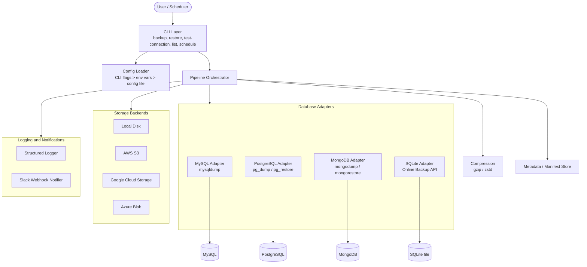
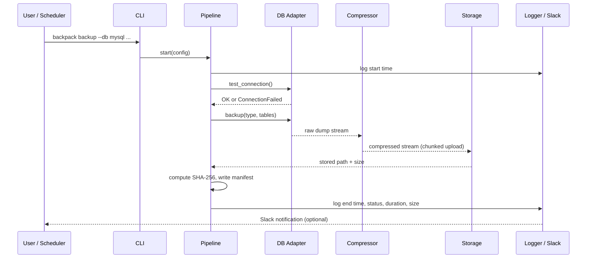
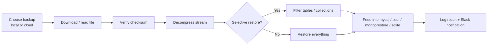

# BackPack: Database Backup Utility

A cross-platform command-line tool to **back up and restore databases** (MySQL, PostgreSQL, MongoDB, SQLite) with compression, local or cloud storage, logging, and Slack notifications.

> **Status:** 🚧 In development (Phase 1: MySQL & PostgreSQL testing)
>
> 📘 **MySQL Testing & Disaster Recovery Guide:** See [MYSQL_TESTING_GUIDE.md](file:///f:/open%20source%20projects/backpack/BackPack/MYSQL_TESTING_GUIDE.md) for hands-on crash simulation, failure recovery, and zero-lock concurrency tests.
>
> 🐘 **PostgreSQL Testing & Disaster Recovery Guide:** See [POSTGRES_TESTING_GUIDE.md](file:///f:/open%20source%20projects/backpack/BackPack/POSTGRES_TESTING_GUIDE.md) for TOC constraint ordering, MVCC snapshot isolation, and drop recovery tests.

---

## Table of Contents

1. [Problem Statement](#problem-statement)
2. [Why This Project?](#why-this-project)
3. [Features](#features)
4. [Architecture](#architecture)
5. [Backup Flow](#backup-flow)
6. [Restore Flow](#restore-flow)
7. [Backup Types](#backup-types)
8. [Tech Stack](#tech-stack)
9. [Project Structure](#project-structure)
10. [Planned CLI Usage](#planned-cli-usage)
11. [Configuration](#configuration)
12. [Security Considerations](#security-considerations)
13. [Roadmap](#roadmap)
14. [Existing Solutions](#existing-solutions)
15. [Team](#team)

---

## Problem Statement

Applications store critical data (users, orders, payments) in databases. If that data is lost or corrupted, the business can fail. Taking reliable backups across different database systems is hard:

- Every DBMS has its own backup tool and flags.
- Manual backups get forgotten.
- Large databases need compression and streaming to stay manageable.
- Backups stored on the same server die with the server.
- Backups often fail silently, and nobody finds out until restore time.
- Restoring in an emergency is stressful and error-prone.

**BackPack** is a single CLI that connects to a database, dumps it, compresses it, stores it locally or in the cloud, logs the result, notifies the team, and can restore it later (fully or selectively).

---

## Why This Project?

Real incidents that show why reliable backups matter:

| Incident | What happened | Lesson |
|---|---|---|
| **GitLab (2017)** | A production database directory was deleted by mistake; most backup mechanisms turned out not to work. | An untested backup is not a backup. Log, verify, and test restores. |
| **Pixar, Toy Story 2 (1998)** | Files were deleted accidentally; backups had been failing silently. | Backups fail silently. Alert on failures. |
| **Code Spaces (2014)** | Attackers deleted both data and backups kept in the same account. | Keep backups in a separate location with separate credentials. |
| **OVHcloud fire (2021)** | A data center fire destroyed servers and backups stored in the same site. | Follow the 3-2-1 rule: 3 copies, 2 media types, 1 offsite. |
| **Ransomware** | Data encrypted by attackers. | Clean, encrypted, offsite backups are the last line of defense. |
| **Human error** | `DROP TABLE` or `DELETE` without `WHERE`. | Support selective restore of a single table or collection. |

---

## Features

### Database connectivity
- Support for **MySQL, PostgreSQL, MongoDB, SQLite**
- Connection parameters: host, port, username, password, database name
- Connection testing before any backup
- Clear error handling for connection failures

### Backup operations
- **Full** backups for all supported databases
- **Incremental / differential** where the DBMS supports it (falls back to full with a warning otherwise)
- **Compression** (gzip, optionally zstd)
- Streaming pipeline, so large databases do not need to fit in memory

### Storage
- Local filesystem
- AWS S3, Google Cloud Storage, Azure Blob Storage

### Logging and notifications
- Logs: start time, end time, duration, status, size, errors
- Optional **Slack** notification on completion

### Restore
- Full restore from a backup file
- **Selective restore** of specific tables or collections where supported

---

## Architecture

### High-level view



### Layers explained

| Layer | Responsibility |
|---|---|
| **CLI layer** | Parses commands and flags, shows help, returns correct exit codes. |
| **Config layer** | Merges settings from CLI flags, environment variables, and a YAML config file (in that priority order). |
| **Pipeline orchestrator** | Connects the steps: dump, compress, (encrypt), upload, record metadata, notify. |
| **Database adapters** | One class per DBMS behind a common interface. They wrap the native dump and restore tools. |
| **Storage backends** | One class per storage target behind a common interface (upload, download, list, delete). |
| **Metadata store** | A manifest per backup: ID, DB type, backup type, parent backup, timestamp, size, SHA-256 checksum. Required for incremental chains and verification. |
| **Logging and notifier** | Records every run and sends Slack alerts for success or failure. |

### Key design decisions

1. **Orchestrator, not a database engine.** We wrap proven tools (`mysqldump`, `pg_dump`, `mongodump`, the SQLite backup API) rather than reimplementing dump logic.
2. **Adapter pattern for databases.** Every DBMS implements the same interface, so adding a new database does not change the rest of the code.
3. **Strategy pattern for storage.** Local, S3, GCS, and Azure all implement one `StorageBackend` interface.
4. **Streaming everywhere.** Data flows through OS pipes in chunks (`dump | compress | upload`), keeping memory use flat even for very large databases.
5. **Check every process in the pipeline.** A failed dump can still produce a valid-looking empty `.gz`, so each process's exit code is verified.
6. **Safe credential handling.** Passwords are passed through environment variables or option files, never as visible command-line arguments.
7. **Clean up on failure.** Partial or corrupt backup files are removed if a run fails.

### Core interfaces (contract)

```python
class DatabaseAdapter(ABC):
    def test_connection(self) -> None: ...            # raises ConnectionFailed
    def backup(self, backup_type, tables=None): ...   # returns a byte stream
    def restore(self, stream, tables=None): ...
    def list_tables(self) -> list[str]: ...

class StorageBackend(ABC):
    def upload(self, name, stream) -> str: ...
    def download(self, name): ...
    def list(self, prefix="") -> list: ...
    def delete(self, name) -> None: ...
```

---

## Backup Flow



---

## Restore Flow



---

## Backup Types

| Type | Contains | Needed to restore |
|---|---|---|
| **Full** | Entire database | That one backup |
| **Differential** | Changes since the last **full** backup | Last full + latest differential |
| **Incremental** | Changes since the last backup of **any** type | Last full + all incrementals in order |

Incremental and differential backups depend on each database's change log:

| Database | Mechanism | Plan |
|---|---|---|
| MySQL | Binary logs (binlog) | Implement first |
| PostgreSQL | WAL archiving | Stretch goal |
| MongoDB | Oplog | Stretch goal |
| SQLite | No change log | Falls back to full with a warning |

### Selective restore support

| Database | Approach |
|---|---|
| MongoDB | `mongorestore --nsInclude` |
| PostgreSQL | Custom-format dump (`-Fc`) with `pg_restore -t` |
| MySQL | Per-table dump files created at backup time |
| SQLite | Restore then copy the needed table, or per-table dump |

---

## Tech Stack

The language is not finalized yet. Below are the options for both **Go** and **Python**. The native tools wrapped by BackPack are the same in both cases.

### Common to both

| Purpose | Choice |
|---|---|
| Native tools wrapped | `mysqldump`, `pg_dump`, `pg_restore`, `mongodump`, `mongorestore`, SQLite backup API |
| Local S3 testing | MinIO |
| Containers for testing | Docker, Docker Compose |
| CI | GitHub Actions |

### Option A: Python

| Purpose | Choice |
|---|---|
| Language | Python 3.11+ |
| CLI framework | Typer + Rich |
| Connection testing | PyMySQL, psycopg, pymongo, sqlite3 |
| Compression | gzip (stdlib), zstandard |
| Cloud storage | boto3 (S3), google-cloud-storage, azure-storage-blob |
| Scheduling | APScheduler or OS cron / Task Scheduler |
| Config and validation | PyYAML, pydantic |
| Logging | logging (stdlib) with JSON formatter |
| Notifications | requests (Slack Incoming Webhook) |
| Encryption (optional) | cryptography (AES-256) |
| Testing | pytest |
| Packaging | pyproject.toml, pipx, optionally PyInstaller |

### Option B: Go

| Purpose | Choice |
|---|---|
| Language | Go 1.22+ |
| CLI framework | Cobra (with Viper for config) |
| Connection testing | go-sql-driver/mysql, pgx, mongo-go-driver, modernc.org/sqlite |
| Compression | compress/gzip (stdlib), klauspost/compress (zstd) |
| Cloud storage | aws-sdk-go-v2 (S3), cloud.google.com/go/storage, azure-sdk-for-go (azblob) |
| Scheduling | robfig/cron or OS cron / Task Scheduler |
| Config and validation | Viper, go-playground/validator, gopkg.in/yaml.v3 |
| Logging | log/slog (stdlib) |
| Notifications | net/http (stdlib) for Slack Incoming Webhook |
| Encryption (optional) | crypto/aes with GCM (stdlib) or filippo.io/age |
| Testing | testing (stdlib), testify, testcontainers-go |
| Packaging | Single static binary, GoReleaser |

---

## Project Structure

```
backpack/
├── pyproject.toml
├── README.md
├── docker-compose.yml          # MySQL, Postgres, Mongo, MinIO for testing
├── docs/
├── src/backpack/
│   ├── cli.py                  # Typer commands
│   ├── config.py               # config loading and validation
│   ├── pipeline.py             # dump -> compress -> upload orchestration
│   ├── metadata.py             # manifests and backup chains
│   ├── notifier.py             # Slack notifications
│   ├── logger.py               # structured logging
│   ├── scheduler.py            # scheduling
│   ├── exceptions.py           # ConnectionFailed, BackupFailed, StorageError
│   ├── adapters/
│   │   ├── base.py
│   │   ├── mysql.py
│   │   ├── postgres.py
│   │   ├── mongodb.py
│   │   └── sqlite.py
│   └── storage/
│       ├── base.py
│       ├── local.py
│       ├── s3.py
│       ├── gcs.py
│       └── azure.py
└── tests/
```

---

## Planned CLI Usage

> These commands show the intended interface and are not implemented yet.

```bash
# Test credentials
backpack test-connection --db postgres --host localhost --user admin --database shop

# Full backup to local disk
backpack backup --db mysql --database shop --type full --storage local --path ./backups

# Backup to S3 with Slack notification
backpack backup --config shop.yaml --storage s3 --notify slack

# List available backups
backpack list --storage s3

# Restore everything
backpack restore --db mysql --database shop --file shop_2026-10-08.sql.gz

# Restore only selected tables
backpack restore --db postgres --file shop.dump --tables orders,users

# Schedule a daily backup at 2 AM
backpack schedule --config shop.yaml --cron "0 2 * * *"
```

---

## Configuration

Settings priority: **CLI flags > environment variables > config file**.

Example `config.yaml`:

```yaml
database:
  type: postgres
  host: localhost
  port: 5432
  user: backup_user
  name: shop
  # password: read from env var BACKPACK_PASSWORD

backup:
  type: full
  compression: gzip
  retention:
    daily: 7
    weekly: 4

storage:
  type: s3
  bucket: my-backups
  region: ap-south-1

notifications:
  slack_webhook: ${SLACK_WEBHOOK_URL}
```

---

## Security Considerations

- Never pass passwords as command-line arguments (visible via `ps`). Use environment variables (`MYSQL_PWD`, `PGPASSWORD`) or option files.
- Never log passwords or secrets.
- Use a dedicated **least-privilege** database user for backups.
- Store credentials in environment variables or a secrets manager. Never commit `.env` files.
- Optional AES-256 encryption of backups at rest.
- SHA-256 checksums to detect corruption or tampering.
- Keep backups in a separate location and account from the database server.

---

## Roadmap

- [ ] **Phase 0:** repo setup, Docker Compose, interface contracts
- [ ] **Phase 1 (MVP):** PostgreSQL full backup and restore, gzip, local storage, logging
- [ ] **Phase 2:** MySQL, MongoDB, SQLite adapters; config file support
- [ ] **Phase 3:** S3 storage (MinIO for testing), then GCS and Azure
- [ ] **Phase 4:** Slack notifications, manifests, `list` command, retention policy
- [ ] **Phase 5:** selective restore, incremental / differential (MySQL first)
- [ ] **Phase 6:** scheduling, encryption, CI, packaging, documentation polish

---

## Existing Solutions

| Tool | About | Built with |
|---|---|---|
| WAL-G | Backup and restore for PostgreSQL, MySQL, MongoDB and others; supports compression, encryption, cloud storage (S3, GCS, Azure), incremental backups and point-in-time recovery. | Go |
| pgBackRest | PostgreSQL-only backup tool with full, differential and incremental backups, parallel operation, cloud storage and retention management. | C |
| Barman | PostgreSQL backup and disaster-recovery manager using WAL archiving and point-in-time recovery. | Python |
| Percona XtraBackup | Physical, hot (no downtime) and incremental backups for MySQL / MariaDB. | C / C++ |
| Percona Backup for MongoDB | Consistent backups and point-in-time recovery for MongoDB replica sets and sharded clusters. | Go |
| Litestream | Continuously streams SQLite changes to cloud storage such as S3. | Go |
| Restic | File-level backup with deduplication, encryption and cloud backends; not database-aware. | Go |
| Borg | File-level backup with deduplication and compression; not database-aware. | Python (with Cython and C extensions) |
| Rclone | Syncs and copies files to and from cloud storage ("rsync for the cloud"); not database-aware. | Go |
| Cloud-managed (RDS, Cloud SQL, Atlas) | Provider-specific managed backups and snapshots, tied to one cloud and one database service. | Proprietary (closed source) |

**Our positioning:** a simple, open-source, cross-platform CLI that gives small teams one consistent interface across several databases, with local and cloud storage, logging, and Slack alerts. We are not trying to replace production-grade tools; this project focuses on unified usability and learning how these systems work.

---

## Team

| Name | Role |
|---|---|
| _Anjani_ | _e.g. Platform side: CLI, storage, notifications_ |
| _Rajat_ | _e.g. Database side: adapters, backup and restore logic_ |

---

## License

To be decided (MIT is a common choice).
