# BackPack: System Architecture & Deep Dive

A comprehensive architectural document detailing the engineering principles, failure analyses, comparative diagrams, and future roadmap of **BackPack**.

---

## 1. Executive Summary & Core Philosophy

BackPack is an open-source, database-agnostic backup and disaster recovery orchestrator written in Go. Rather than reinventing low-level storage engines, BackPack treats proven database dump engines (`pg_dump`, `mysqldump`, `mongodump`, SQLite Online Backup API) as subprocess providers and orchestrates streaming compression, credential isolation, validation, and multi-backend persistence.

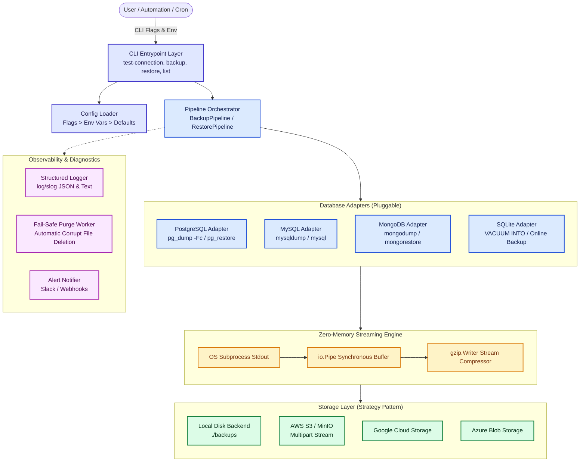

---

## 2. Comparative Matrix: Old Legacy Methods vs. BackPack

| Challenge / Dimension | Legacy Shell Scripts & Naive Tools | BackPack Architecture |
|---|---|---|
| **Pipeline Failure Detection** | Pipes mask exit codes (`pg_dump \| gzip > out.gz` always returns `0`), creating empty corrupted backups. | Subprocess exit codes and `stderr` are monitored via custom `execReadCloser`. Failed dumps immediately abort. |
| **Partial File Cleanup** | Corrupt partial files remain on disk, masquerading as valid backups until disaster strikes. | Atomic fail-safe cleanup: any error during streaming immediately triggers `Storage.Delete(backupName)`. |
| **RAM Footprint** | Buffers entire dump in memory or writes huge intermediate uncompressed files to disk. | Constant $O(1)$ RAM usage using synchronous `io.Pipe()` streaming directly from subprocess into gzip. |
| **Database Lock Contention** | Global table locking (`FLUSH TABLES WITH READ LOCK`) stalls web traffic and times out queries. | Non-blocking MVCC snapshot isolation (`--single-transaction` on MySQL, `REPEATABLE READ` on Postgres). |
| **Credential Security** | Passwords passed as visible CLI arguments (`-p password`), exposed in `ps aux` and Task Manager. | Complete credential isolation: credentials injected exclusively into private child process environment blocks. |
| **Foreign Key Restores** | Flat SQL files insert child rows before parent rows, causing `Error 1452` foreign key violations. | Postgres: 3-phase Table of Contents (TOC) ordering.<br/>MySQL: Automatic `SET FOREIGN_KEY_CHECKS=0`. |
| **Total Database Drop** | Restore crashes if database doesn't exist (`Unknown database` error). | Self-healing restore: connects to maintenance database and auto-provisions missing databases. |
| **Archive Corruption** | Corrupt archives stream junk directly into the database engine before failing. | Header and CRC verification halts corrupted files before modifying any database state. |

---

## 3. Deep-Dive: Core Problems & How BackPack Solves Them

---

### Problem 1: The "Silent Zombie" Backup Trap

#### The Problem
In standard DevOps bash scripts, engineers typically write:
```bash
pg_dump -U postgres shop_db | gzip > /backups/shop_db.sql.gz
```
In Unix and Windows PowerShell pipelines, the exit code of a pipeline is determined by the **last command in the pipe** (`gzip`). If `pg_dump` fails immediately (e.g. bad password, network timeout, insufficient permissions), `pg_dump` outputs an error to `stderr` and closes stdout. However, `gzip` simply reads an empty stream, compresses zero bytes, appends a valid 20-byte gzip header/footer, and **exits with code 0**. 

The cron job thinks the backup succeeded. When production suffers data loss months later, the team discovers every backup is an empty 20-byte file.

```mermaid
flowchart TD
    classDef bad fill:#fee2e2,stroke:#ef4444,stroke-width:2px,color:#991b1b;
    classDef good fill:#dcfce7,stroke:#22c55e,stroke-width:2px,color:#166534;
    classDef neutral fill:#f3f4f6,stroke:#6b7280,stroke-width:2px,color:#1f2937;

    subgraph Legacy["Legacy Naive Shell Pipe"]
        DumpBad["pg_dump FAILS (Exit Code 1)"]:::bad -->|Empty stdout| GzipBad["gzip processes 0 bytes (Exit Code 0)"]:::neutral
        GzipBad --> FileBad["Corrupt 20-byte file saved to disk"]:::bad
        FileBad --> CronBad["Cron reports SUCCESS (Disaster!)"]:::bad
    end

    subgraph BackPackPipe["BackPack Managed Execution Pipeline"]
        DumpGood["pg_dump / mysqldump Worker"]:::neutral -->|Stdout Pipe| Watcher["execReadCloser Stream Monitor"]:::good
        Watcher --> Pipe["Synchronous io.Pipe"]:::good
        Pipe --> Compress["gzip.Writer"]:::good
        Compress --> Store["Storage Upload"]:::good

        Watcher -.->|Subprocess Exits with Error| Trap["Exit Code Trapped & Stderr Captured"]:::bad
        Trap --> Purge["Storage.Delete(backupName)"]:::good
        Purge --> Alert["Log Error & Exit Code 1 (No Corrupt File Left)"]:::good
    end
```

#### How BackPack Solves It
BackPack implements a dedicated `execReadCloser` in [adapters/postgres.go](file:///f:/open%20source%20projects/backpack/BackPack/adapters/postgres.go) and [adapters/mysql.go](file:///f:/open%20source%20projects/backpack/BackPack/adapters/mysql.go):
1. It separates `stdout` (the data stream) from `stderr` (error logs).
2. When the compressor reads `EOF`, `Close()` executes `cmd.Wait()` on the database process.
3. If the subprocess exited with non-zero status, the error channel notifies [pipeline.go](file:///f:/open%20source%20projects/backpack/BackPack/pipeline/pipeline.go).
4. The pipeline immediately calls `Storage.Delete(backupName)`, purging the partial file from disk and ensuring zero corrupt archives exist in storage.

---

### Problem 2: RAM Exhaustion & The Out-Of-Memory (OOM) Killer

#### The Problem
Many backup scripts read the entire output into a memory buffer (`ioutil.ReadAll` / `byte[]`) before sending it to a compressor or cloud bucket.
* For a 50MB database, this works fine.
* For a 50GB production database, loading the raw dump into RAM causes memory exhaustion, triggering the OS Out-Of-Memory (OOM) killer, which terminates the backup or the database server itself.

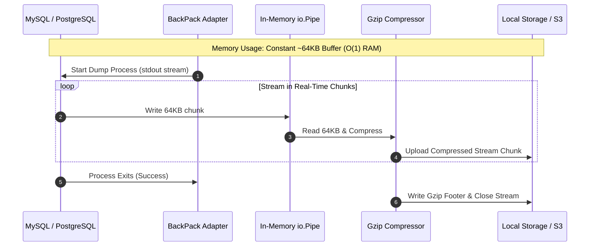

#### How BackPack Solves It
BackPack utilizes Go's synchronous `io.Pipe()`:
* The subprocess writes chunks directly to `pw (*io.PipeWriter)`.
* The compression goroutine reads from `pr (*io.PipeReader)` and writes compressed blocks straight to the storage destination.
* Memory usage remains flat (typically under 10MB of buffer RAM), regardless of whether the database contains 1,000 rows or 100,000,000 rows.

---

### Problem 3: Table Freezes & Locking Lockouts

#### The Problem
Traditional tools often acquire read locks on tables (`FLUSH TABLES WITH READ LOCK` in MySQL or exclusive table locks in PostgreSQL).
* While the backup runs, all incoming web application `INSERT`, `UPDATE`, and `DELETE` queries are placed in a queue.
* Connection pools saturate, API requests time out with HTTP 504 Gateway Timeout, and the site crashes during the backup window.

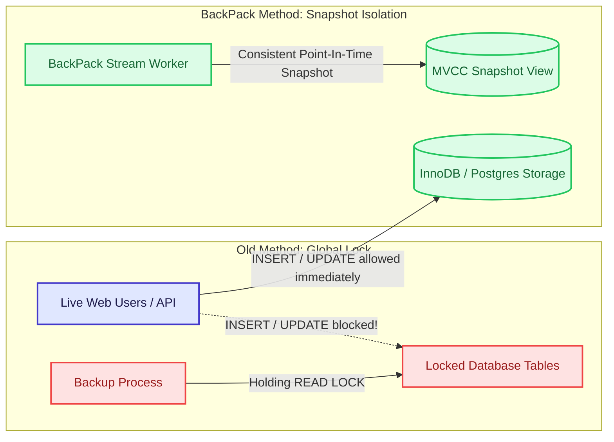

#### How BackPack Solves It
* **In MySQL:** BackPack forces `--single-transaction` and `--quick`. This starts an InnoDB transaction with `REPEATABLE READ` snapshot isolation. Web users can write and update records concurrently without experiencing lock delays.
* **In PostgreSQL:** BackPack runs in `REPEATABLE READ` snapshot mode with `pg_dump -Fc`. It acquires only `ACCESS SHARE` locks, allowing live transactions to continue running uninterrupted.

---

### Problem 4: Foreign Key Dependency & Restoration Deadlocks

#### The Problem
In relational databases, child tables (`order_items`) hold foreign keys pointing to parent tables (`orders` -> `customers`).
In legacy plain SQL dumps:
1. `CREATE TABLE order_items` runs before `orders` exists -> **Fails with Table Not Found**.
2. Or data is loaded into `order_items` before `orders` rows exist -> **Fails with Foreign Key Constraint Violation (Error 1452)**.

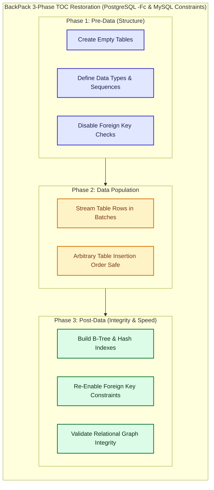

#### How BackPack Solves It
* **PostgreSQL:** BackPack's `-Fc` format compiles an embedded Table of Contents (TOC). `pg_restore` executes a clean 3-phase restoration:
  1. **Pre-Data:** Schemas and tables are created without foreign keys.
  2. **Data:** Raw rows are ingested rapidly without checking constraints on every single row.
  3. **Post-Data:** Indexes, triggers, and foreign key constraints are established and validated in bulk at the end.
* **MySQL:** BackPack ensures dumps contain `/*!40014 SET @OLD_FOREIGN_KEY_CHECKS=@@FOREIGN_KEY_CHECKS, FOREIGN_KEY_CHECKS=0 */;`, temporarily disabling constraint evaluation during the stream and re-enabling it upon completion.

---

### Problem 5: Security & Credential Leakage

#### The Problem
Passing passwords directly to commands (e.g. `pg_dump -W` or `mysqldump -pSecretPass`) makes credentials visible to:
* Every user on the server via `ps -ef` or `ps aux`.
* Monitoring daemons, audit logs, and shell history (`.bash_history`).
* Windows Task Manager and Sysinternals Process Explorer.

```mermaid
flowchart LR
    classDef danger fill:#fee2e2,stroke:#ef4444,stroke-width:2px,color:#991b1b;
    classDef secure fill:#dcfce7,stroke:#22c55e,stroke-width:2px,color:#166534;

    subgraph Insecure["Legacy Insecure Invocation"]
        Cmd1["mysqldump -u root -pPassword123 mydb"]:::danger
        Cmd1 -.-> Exposed["Visible to any user via 'ps aux' or Task Manager!"]:::danger
    end

    subgraph Secure["BackPack Secure Subprocess Isolation"]
        BackPackExec["BackPack Process"]:::secure
        BackPackExec -->|cmd.Env = append(PGPASSWORD / MYSQL_PWD)| SubProcess["Isolated Child Worker"]:::secure
        SubProcess -.-> Safe["Process arguments contain ZERO credentials: 'mysqldump -u root mydb'"]:::secure
    end
```

#### How BackPack Solves It
BackPack injects credentials strictly through the child process's isolated environment block (`cmd.Env`), passing `PGPASSWORD` for PostgreSQL and `MYSQL_PWD` for MySQL. Command-line arguments (`os.Args`) remain completely sterile and safe from process snooping.

---

### Problem 6: Self-Healing Complete Database Re-Creation

#### The Problem
When a human error leads to `DROP DATABASE shop;`, traditional restoration tools fail:
* `pg_restore -d shop ...` -> `FATAL: database "shop" does not exist`.
* `mysql -u root shop ...` -> `ERROR 1049: Unknown database 'shop'`.
The engineer must manually open an interactive SQL prompt, create the database, and re-run the tool.

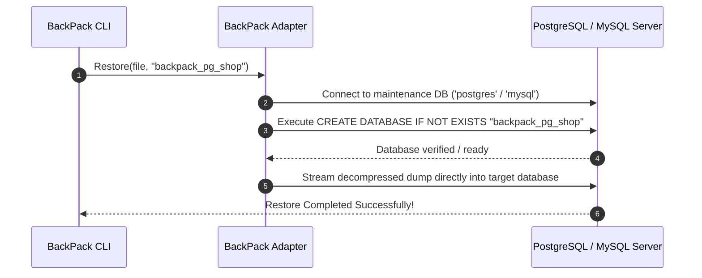

#### How BackPack Solves It
BackPack automatically connects to the server's default maintenance catalog (`postgres` for PostgreSQL, or `mysql` for MySQL) and runs `CREATE DATABASE IF NOT EXISTS` before piping the restore stream. The restore completes in a single command, even if the database was completely wiped.

---

## 4. Future Implementations & Architectural Roadmap

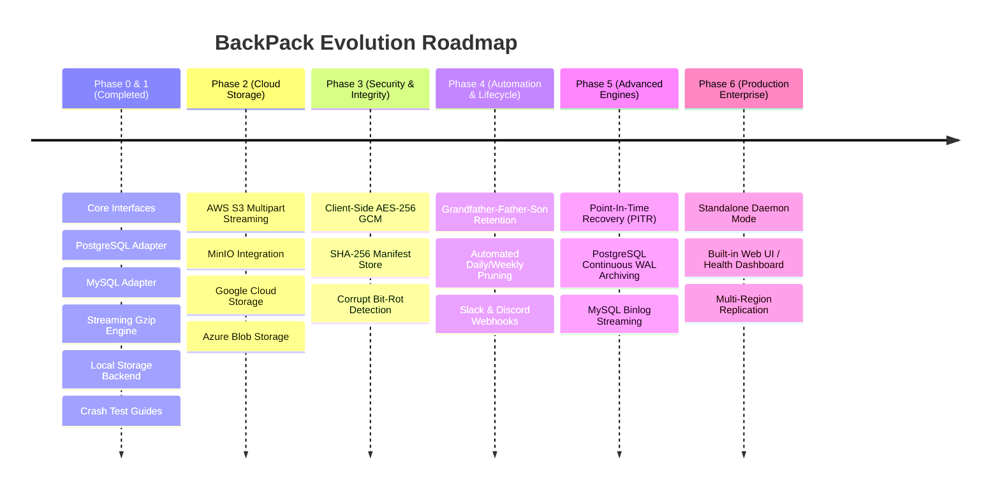

---

### Future 1: Cloud Storage Streaming (AWS S3, MinIO, GCS, Azure)

Instead of saving files to local disk first and uploading them later (which requires double the disk space), BackPack's `StorageBackend` interface will stream multipart uploads straight to cloud storage:

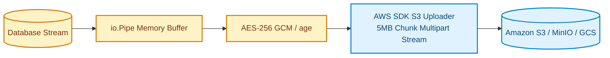

* **Zero Local Disk Requirement:** Databases stream directly to S3/MinIO in 5MB multipart chunks.
* **Support for MinIO:** Developers can test S3 cloud workflows locally using the included `docker-compose.yml`.

---

### Future 2: Client-Side Envelope Encryption (AES-256 GCM)

To protect backups stored in untrusted cloud environments, BackPack will implement client-side streaming encryption:

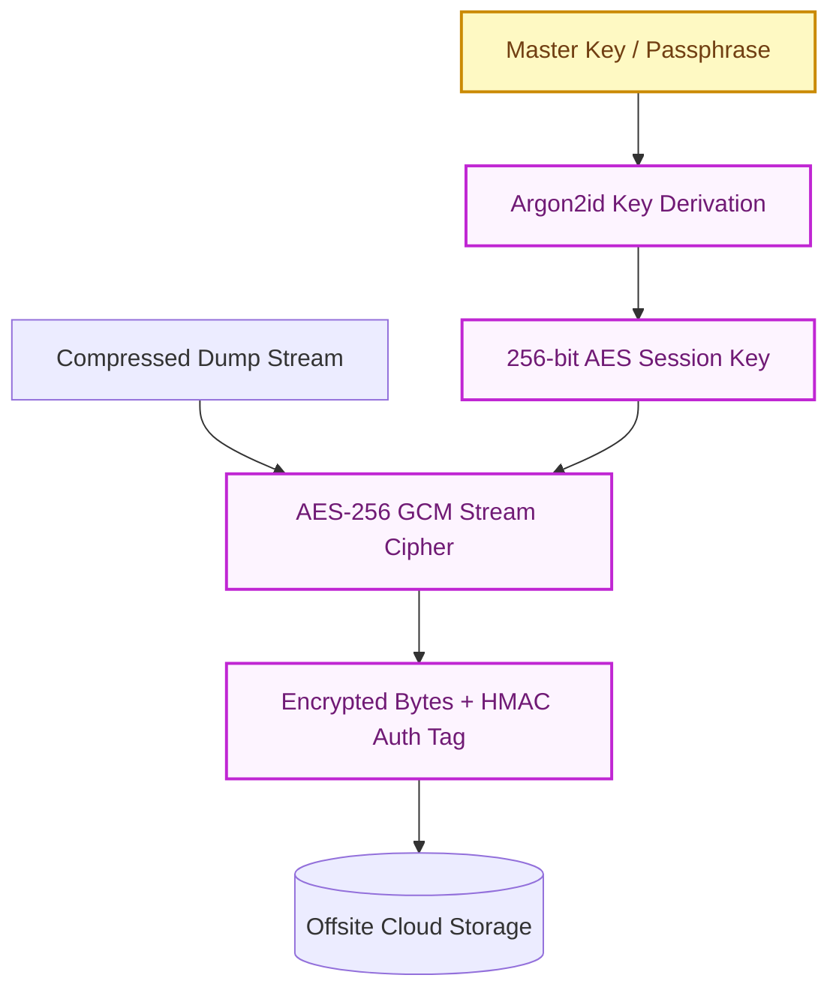

* **Zero-Knowledge Architecture:** The cloud provider only sees encrypted ciphertext.
* **Tamper-Proof Integrity:** AES-GCM authentication tags prevent undetected bit manipulation or tampering.

---

### Future 3: Grandfather-Father-Son (GFS) Retention & Manifest Ledger

To prevent storage buckets from filling up, BackPack will automate backup lifecycle management:

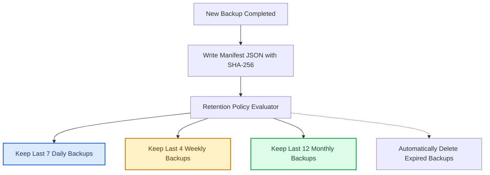

* **Manifest File (`manifest.json`):** Tracks backup ID, database type, timestamp, compressed size, uncompressed size, and SHA-256 hash.
* **Smart Pruning:** Retains 7 daily, 4 weekly, and 12 monthly backups, automatically cleaning up intermediate files.

---

### Future 4: Point-In-Time Recovery (PITR) via Continuous WAL / Binlog Archiving

While daily logical backups protect against catastrophic data loss, transactions occurring between backups are lost. Point-In-Time Recovery bridges this gap:

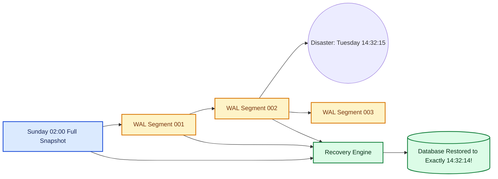

* **PostgreSQL:** Archive continuous Write-Ahead Log (WAL) segments to S3.
* **MySQL:** Stream binary logs (`mysqlbinlog`) continuously.
* **Target Recovery:** Restore the base snapshot, then replay transactions up to the exact second before an accidental `DROP TABLE` occurred.

---

### Future 5: Real-Time Alerts & Observability (Slack, Discord, Webhooks)

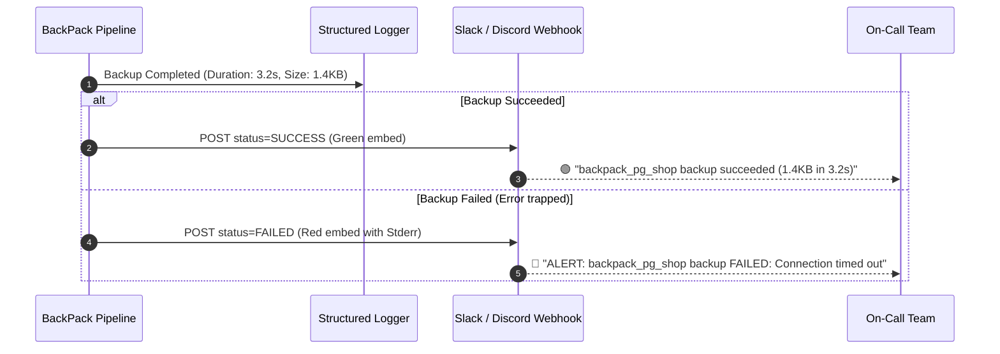

---

## 5. Summary

BackPack elevates database backups from fragile shell scripts into a resilient, memory-safe, and self-healing system:
1. **Streaming Everything:** Constant $O(1)$ RAM usage via `io.Pipe()`.
2. **Fail-Safe Integrity:** Process exit codes are verified and broken partial files are automatically purged.
3. **Zero Locking:** Non-blocking snapshot isolation protects live web application performance.
4. **Resilient Recovery:** Intelligent schema creation and constraint management prevent restoration deadlocks.
